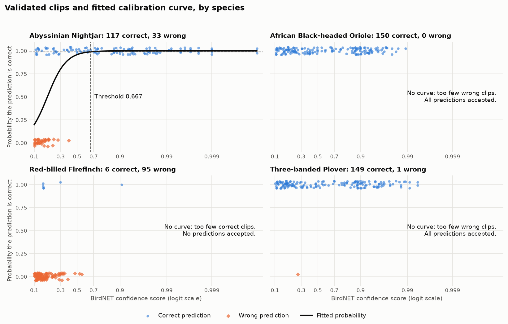

# Bird Challenge: Report

Deriving bird observations from BirdNET predictions, using ornithologist-validated clips and a 99% probability of correctness.

## Summary

BirdNET produced 29,491 predictions for four species. Using 551 validated clips, each species was given a rule for deciding which predictions count as observations. 22,216 predictions (75.3%) are labelled as observations.

| Species | Validated: correct of total | Method | Threshold | Predictions | Observations |
|---|---|---|---|---|---|
| Abyssinian Nightjar | 117 of 150 | Fitted curve | 0.667 | 10,187 | 3,147 (30.9%) |
| African Black-headed Oriole | 150 of 150 | Accept all | none | 18,054 | 18,054 (100%) |
| Three-banded Plover | 149 of 150 | Accept all | none | 1,015 | 1,015 (100%) |
| Red-billed Firefinch | 6 of 101 | Accept none | none | 235 | 0 (0%) |

The method in Wood and Kahl (2024) works as intended for one species, the Nightjar. The other three do not have enough of both outcomes in the validated sample for a curve to be fitted reliably, so a rule is applied instead. Those rules, and their weaknesses, are the main decisions in this report.

The new field is called `observation`. It holds the species name when the clip is an observation and is empty otherwise.

## The data

| File | Rows | Contents |
|---|---|---|
| `birdnet_predictions.csv` | 29,491 | One row per 3-second clip and predicted species, with a confidence score |
| `validation_results.csv` | 551 | Clips an ornithologist listened to, each marked correct (1) or incorrect (0) |

- **Coverage:** 4 species, 43 recorders, 1,696 one-hour recordings, 20 June to 12 July 2023, BirdNET v2.4.
- **Minimum score:** nothing below 0.10 was stored, so nothing can be said about lower scores.
- **What `outcome` measures:** whether the species BirdNET named is in the clip. It does not say what else was there, and it says nothing about calls BirdNET missed. The data supports statements about precision, not recall.
- **Link between the files:** by species only. The validation file has no clip offset, so validated clips cannot be matched to rows in the predictions file. The validated clips come from 32 of the same 43 recorders and the same dates.

## Method

For each species separately:

1. **Transform the score.** Convert the confidence score to the logit scale, `ln(score / (1 - score))`. The paper recommends this because high scores are compressed near 1 on the original scale.
2. **Fit the curve.** A logistic regression of `outcome` on the logit score. This relates the score to the probability that a prediction is correct.
3. **Solve for the threshold.** Find the score at which the fitted probability is 0.99.
4. **Label.** A prediction at or above its species' threshold is an observation.

**What the threshold means.** The threshold is the confidence score at which a prediction's probability of being correct reaches 99%. Predictions above it are more likely still to be correct, so this implies a positive predictive value (precision) of at least 99% for the observations, to the extent that the fitted curve is right. It is a statement about how trustworthy the kept predictions are. It says nothing about recall, the share of correct predictions that are kept.

In machine learning terms this is calibration: turning a model's raw score into a probability.

Each point is a validated clip, placed at 1 if BirdNET was correct and 0 if not, with a little vertical spread so that overlapping points stay visible. The horizontal axis is on the logit scale and labelled with the confidence scores those positions correspond to.

The figure shows why one method cannot serve all four species. Only the Nightjar has correct and incorrect clips that separate along the score axis. The Oriole and the Plover are correct across the whole range, and the Firefinch is incorrect almost everywhere.

## Results by species

### Abyssinian Nightjar: fitted threshold of 0.667

The curve fits well. Incorrect clips are concentrated at low scores (the highest is 0.396), and the fitted probability reaches 0.99 at a score of 0.667.

- **Check against the validated sample:** all 74 validated clips at or above the threshold are correct. Below it, 43 of 76 are.
- **Uncertainty:** refitting on 2,000 bootstrap resamples of the validated clips puts the threshold between 0.45 and 0.82 (95% interval). The number of observations would range from about 4,200 to about 2,300 across that interval.
- **Cost:** the threshold discards roughly 69% of Nightjar predictions. Many of those are correct (more than half of the validated clips below the threshold are), so this is a deliberately conservative rule that trades recall for certainty.

### African Black-headed Oriole: all predictions accepted

All 150 validated clips are correct, across scores from 0.10 to 0.99. With no incorrect clips there is nothing for a curve to separate, and the regression cannot be fitted.

- **Decision:** accept every prediction as an observation.
- **What the evidence supports:** 150 correct out of 150 shows, with 95% confidence, that precision is at least 98.0%. It does not show 99%. That would take about 300 validated clips with no errors.
- **Where those numbers come from:** if precision is `p`, the chance that 150 independent clips are all correct is `p^150`. At exactly 99% that chance is `0.99^150` = 22%, so a clean sample of 150 cannot rule out 99%, or values a little below it. Solving `p^150 = 0.05` gives `p` = 98.0%, the lowest precision that is still consistent with the sample at the usual 5% level. Solving `0.99^n = 0.05` gives `n` = 299, the number of clips with no errors needed to support 99%. A quick check is the rule of three: with no errors in `n` clips, the error rate is at most about `3 / n`.
- **Why accept rather than reject:** the evidence points strongly one way, there is no sign that low-scoring predictions are worse, and rejecting 18,054 predictions that are almost all correct would discard the most informative species in the dataset.

### Three-banded Plover: all predictions accepted

149 of 150 validated clips are correct. The one incorrect clip has a score of 0.264.

A curve can be fitted, and it gives a threshold of 0.259, which would keep 538 of the 1,015 predictions. I chose not to use it, because that threshold rests on a single clip:

- The fitted slope is not statistically distinguishable from zero.
- Changing the fitting method moves the threshold a long way. A penalised (Firth) regression on the same data gives 0.82 instead of 0.26.
- A single different verdict from the ornithologist on that one clip would remove the threshold altogether.

**Decision:** treat the Plover like the Oriole and accept all predictions.

**This is the most debatable call in the analysis.** Observed precision is 99.3%, but with one error in 150 the 95% lower bound is 96.9%, so the 99% target is not demonstrated. The alternative is to apply the fitted threshold of 0.259 and keep 538 observations. I preferred a rule I can state and defend over a number that changes with the method, and I recommend more validation to settle it.

### Red-billed Firefinch: no predictions accepted

Only 6 of 101 validated clips are correct, and five of those six have scores below 0.30, so the score does not separate correct from incorrect either.

- **Decision:** accept no predictions.
- **A fitted curve agrees:** fitting one anyway gives a threshold of 0.998, and the highest Firefinch score in the predictions is 0.907. No clip would qualify.
- **What this means:** BirdNET is not usable for this species with these recordings. This is a finding, not a gap in the method. The 235 predictions are best treated as unverified.

## Labelled results

Applying the four rules to all 29,491 predictions gives the `observation` field.

| Species | Predictions | Labelled as observation | Left empty |
|---|---|---|---|
| African Black-headed Oriole | 18,054 | 18,054 | 0 |
| Three-banded Plover | 1,015 | 1,015 | 0 |
| Abyssinian Nightjar | 10,187 | 3,147 | 7,040 |
| Red-billed Firefinch | 235 | 0 | 235 |
| Total | 29,491 | 22,216 | 7,275 |

The 7,275 predictions left empty are there for two different reasons:

- **Firefinch (235):** none are labelled, whatever their score, because BirdNET was wrong in 95 of the 101 validated clips.
- **Nightjar (7,040):** only predictions with a score of 0.667 or higher are labelled. Those below it are less than 99% likely to be correct according to the fitted curve.

An empty `observation` means "not certain enough to count", not "the species is absent". Many of the unlabelled Nightjar predictions are real: in the validated sample, 43 of the 76 clips below the threshold were correct.

## Decisions and assumptions

| Decision | Choice | Reason |
|---|---|---|
| Scale for the regression | Logit of the confidence score | Recommended by Wood and Kahl; spreads out the compressed high scores |
| Scores of exactly 1.0 | Capped at 0.9999 before the transform | The logit of 1 is infinite. 0.9999 is the highest score below 1 that occurs in the predictions, which are recorded to four decimals. Affects 4 predictions and 2 validated clips |
| BirdNET sensitivity | Assumed to be 1.0, the default | Not recorded in the files. The full transform divides by sensitivity |
| Minimum clips to fit a curve | 10 correct and 10 incorrect | A common rule of thumb for logistic regression. Below it the fit is driven by a handful of clips |
| Too few incorrect clips | Accept all predictions | The validated sample shows predictions are correct across the score range |
| Too few correct clips | Accept none | The validated sample shows predictions cannot be trusted |
| Species with no validated clips | No observations | Nothing is known about its precision |
| Content of `observation` | Species name, or empty | Reads directly as "what was observed in this clip" |
| Comparison with the threshold | At or above | A prediction exactly at the threshold has a fitted probability of 0.99 |

### What I did not do

- **I did not infer incorrect clips from low scores.** Treating low-scoring predictions as wrong would assume the answer. The validated data contradicts it: all 33 validated Oriole clips with scores of 0.20 or below are correct.
- **I did not rebalance the classes.** Oversampling or reweighting changes the proportion of correct clips, and that proportion is what is being estimated.
- **I did not use a penalised regression as the main method.** It always returns a number, including where the data cannot support one. I used it as a check: where it agrees with the ordinary fit (Nightjar, 0.71 against 0.67) the threshold is trustworthy, and where it disagrees (Plover) it is not.

## Limitations

- **The 99% target is met by the model's estimate, not proven.** The threshold is a point estimate with a wide interval, and for two species the claim rests on a sample too small to demonstrate 99%.
- **The validated sample is small and from one period.** Thresholds apply to these recorders, this site and this season. Wood and Kahl are explicit that scores do not transfer between recording set-ups.
- **One person's verdicts are treated as the truth.** A second opinion on borderline clips, the Plover's single incorrect clip in particular, would be worthwhile.
- **Nothing is known about recall.** A species with few observations may be rare, or may be poorly detected.
- **Consecutive clips are not independent.** A bird calling for 30 seconds produces many predictions. Counts of observations measure vocal activity, not numbers of birds.

## Recommendations

1. **Validate more Oriole and Plover clips,** about 150 more of each, weighted towards low scores where an error is most likely to appear. This would either demonstrate 99% or produce enough incorrect clips to fit a curve.
2. **Have the Plover's incorrect clip checked** by a second ornithologist.
3. **Do not report Firefinch presence from BirdNET** for this project without manual confirmation.
4. **Store the fitted probability with each prediction,** not only the yes/no label, so that a different target (95% for instance) can be applied later without refitting.
5. **Repeat the validation** when the recorders, the site or the season change.

## Reproducing this

Run `run_birds.py` from the project root. It writes `class_balance.csv`, `thresholds.csv`, the labelled predictions and the figure to `output_data/birds_output/`.

| Step | Code |
|---|---|
| Count correct and incorrect clips per species | `src/birds_src/class_balance.py` |
| Fit the curve and find the threshold | `src/birds_src/calibrate.py` |
| Add the `observation` field | `src/birds_src/label_predictions.py` |
| Draw the calibration figure | `src/birds_src/plot_calibration.py` |

The labelled predictions file is not in the repository, because it is a full copy of the source data with one added column.

## Reference

Wood, C. M. and Kahl, S. (2024). Guidelines for appropriate use of BirdNET scores and other detector outputs. *Journal of Ornithology*. https://doi.org/10.1007/s10336-024-02144-5
