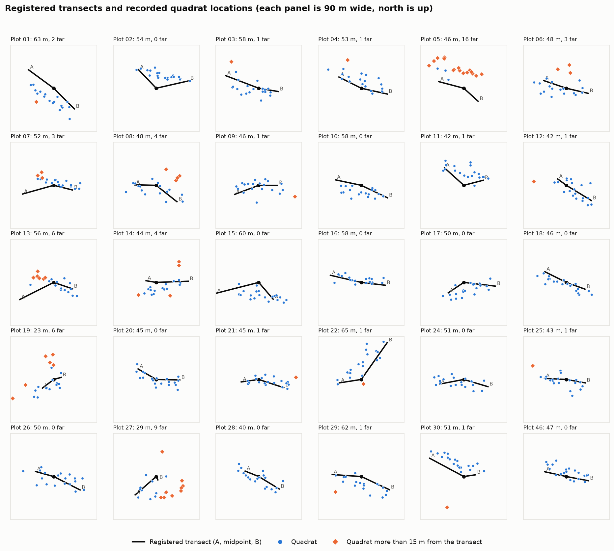
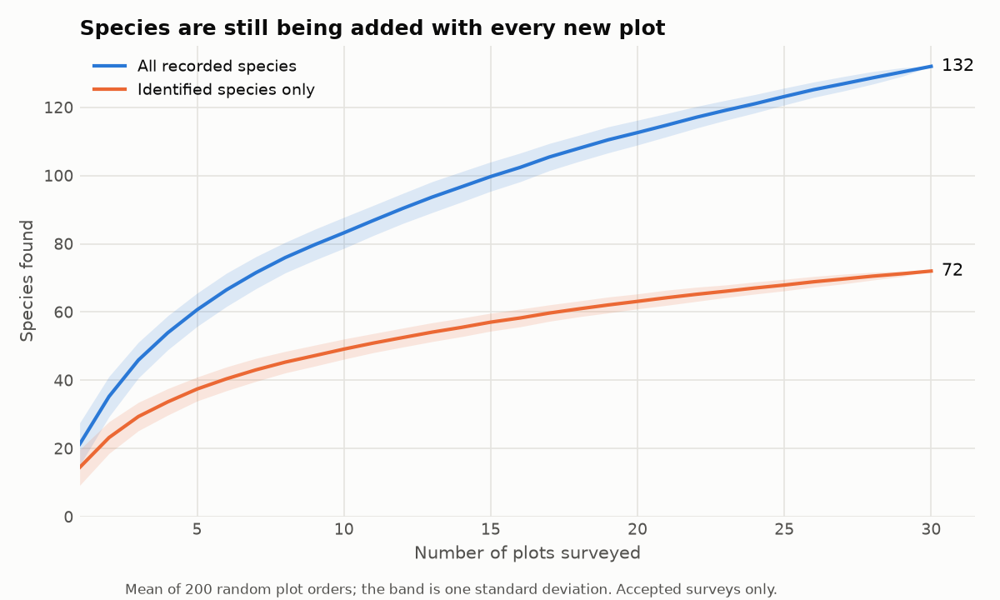
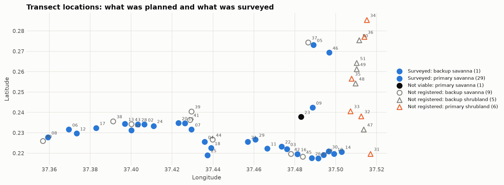

# Vegetation Challenge: Data Quality Report

Herbaceous vegetation surveys, Savanna Monitoring Pilot, Lewa project area, baseline 2026.
Field data collected 19 to 27 May 2026.

## Summary

The field team completed what it set out to do in the savanna stratum: 30 plots surveyed, each with the full 20 quadrats, and every expected photo received. The records are complete and internally consistent enough to work with.

Four issues limit what the data can be used for today:

1. **The shrubland stratum was not sampled.** None of the 11 prescribed shrubland locations (6 primary, 5 backup) were registered or surveyed. Results describe savanna only.
2. **The species list does not fit the site.** Only 28 of the 238 herbaceous species on the approved list were ever selected. 57.5% of species records were entered as additional species, and 30.1% are unidentified.
3. **Species richness is not yet reliable.** The same species appears under several names, some species hold two ids, and 60 of the 132 recorded species are unidentified.
4. **Sampling is not yet sufficient to estimate richness.** New species were still being found at the 30th plot, and an estimated 69% of the species present have been recorded.

The checks raised 234 flags: 16 errors, 116 warnings and 102 informational. No data was changed. Every issue is flagged for the project team to resolve.

## What was checked and how

The analysis reads the four ODK exports and two entity lists, joins them, and runs 33 checks. 25 of them found something.

| Step | What it does | Code |
|---|---|---|
| Load and join | Builds five tables: sampling frame, plots, surveys, quadrats, species records | `src/vegetation_src/load_data.py` |
| Check | Runs each rule and returns one flag per failing record | `src/vegetation_src/quality_checks.py` |
| Report | Builds the summaries, the sampling-effort assessment and the figures | `src/vegetation_src/report.py` |

To reproduce everything in this report, run `run_vegetation.py` from the project root. The outputs are written to `output_data/vegetation_output/`.

### Severity levels

| Severity | Meaning | Flags |
|---|---|---|
| Error | Breaks a written rule, or the record cannot be used as it stands | 16 |
| Warning | Probably wrong; a person needs to look | 116 |
| Info | Worth knowing; may be correct | 102 |

### Decisions made

- **Flag, never fix.** The recorded values are untouched. Derived columns (distances, durations, counts) are added beside them.
- **Rejected surveys are checked but not summarised.** Two surveys are marked `rejected` in ODK. They are flagged like any other, and left out of the plot summary and the richness figures.
- **Species are counted by entity id, not by name.** The form shows one species under different labels, for example `Sida chrysantha` and `herb_063 (Sida chrysantha)`. Counting names gives 181 species; counting ids gives 132.
- **Rules come from two places.** Where the SOP or the form states a rule, the check uses it. Where neither does, I chose a tolerance and say so below.

| Rule | Value | Source |
|---|---|---|
| Quadrats per survey | 20 | SOP and form |
| GPS accuracy | 5 m or better | SOP and form |
| Transect length | 50 m | SOP |
| Midpoint within the prescribed location | 25 m | SOP |
| Transect orientation | North to south | SOP |
| Typed species name format | `Genus_species` | SOP |
| Transect length tolerance | 10 m either side of 50 | My choice: two endpoint fixes of about 5 m each |
| Midpoint central | A-to-midpoint and midpoint-to-B within 10 m of each other | My choice |
| Quadrat to transect | 15 m at most | My choice: 2.5 m belt plus about 5 m of GPS error on each of the two positions |
| Survey duration | 30 to 180 minutes | My choice: the middle half of surveys took 54 to 80 minutes |

## Flags raised

| Level | Check | Severity | Flags | Plots affected |
|---|---|---|---|---|
| Survey | Plot surveyed more than once | Error | 4 | 2 |
| Survey | Survey too fast (under 30 minutes) | Warning | 2 | 2 |
| Survey | End location missing | Warning | 3 | 3 |
| Survey | Survey rejected in review | Info | 2 | 2 |
| Survey | Backup plot surveyed | Info | 1 | 1 |
| Survey | Survey too slow (over 180 minutes) | Info | 1 | 1 |
| Plot | Midpoint more than 25 m from the prescribed location | Error | 1 | 1 |
| Plot | Midpoint not central | Warning | 11 | 11 |
| Plot | Transect length off | Warning | 6 | 6 |
| Plot | Geohash differs from the prescribed one | Warning | 3 | 3 |
| Plot | Transect not north to south | Info | 30 | 30 |
| Plot | Plot not viable | Info | 1 | 1 |
| Quadrat | Additional species declared but none entered | Error | 10 | 8 |
| Quadrat | Quadrat more than 15 m from the transect | Warning | 64 | 20 |
| Quadrat | Two quadrats at identical coordinates | Warning | 2 | 1 |
| Quadrat | Photo taken out of order | Warning | 1 | 1 |
| Quadrat | Comment not informative | Info | 15 | 10 |
| Quadrat | No herbs recorded | Info | 7 | 6 |
| Species | Species name missing | Error | 1 | 1 |
| Species | Species repeated in a quadrat | Warning | 14 | 4 |
| Species | Typed species registered twice | Warning | 4 | 4 |
| Species | Typed genus possibly misspelled | Warning | 3 | 3 |
| Species | Typed name has extra spaces | Warning | 2 | 2 |
| Species | Typed species already on the list | Warning | 1 | 1 |
| Species | Typed name not in the SOP format | Info | 45 | 19 |

Eight checks found nothing, which is itself a result: every survey has exactly 20 quadrats with no repeated quadrat numbers, every attachment was received, no survey was made on an unregistered or non-viable plot, every viable plot has its coordinates and an accepted survey, and every GPS fix on a transect or quadrat meets the 5 m accuracy rule.

The full list, one row per flag with the record it refers to, is in `output_data/vegetation_output/flags.csv`.

## a. Survey-level summary

32 surveys were submitted for 30 plots. 30 are accepted and 2 are rejected.

- **Completeness is good.** Every survey has 20 quadrats and all its attachments.
- **Two plots were surveyed twice.** Plots 18 and 21 each have a second survey made the same afternoon by the other team. Both second surveys are already marked `rejected` in ODK, and both took about 25 minutes against a median of 63. All four surveys are flagged, so the project team can confirm the right one was kept.
- **One survey ran for almost four hours.** Plot 08, the first survey of the campaign, took 236 minutes. The form was probably left open; the data itself looks normal.
- **Three surveys have no end location.** The two rejected surveys and Plot 29. All three came from the same device, which submitted four surveys in total, so this points to a device setting and not to the recorders.
- **Recording was concentrated in one person.** Grace recorded 26 of the 32 surveys and Sam 6. Differences between plots may partly reflect differences between recorders.
- **The unidentified share varies widely,** from 9% to 74% of a survey's records.

| Plot | Date | Recorder | Submitted by | Minutes | Review state | Quadrats | With herbs | Records | Species | Unidentified % | Errors | Warnings |
|---|---|---|---|---|---|---|---|---|---|---|---|---|
| Plot 08 | 2026-05-19 | Sam | Team 1 | 236 | not reviewed | 20 | 20 | 103 | 26 | 29.1 | 0 | 5 |
| Plot 12 | 2026-05-20 | Sam | Team 1 | 165 | not reviewed | 20 | 20 | 108 | 35 | 39.8 | 0 | 7 |
| Plot 22 | 2026-05-20 | Sam | Team 1 | 73 | not reviewed | 20 | 20 | 65 | 20 | 21.5 | 0 | 3 |
| Plot 03 | 2026-05-20 | Sam | Team 1 | 59 | not reviewed | 20 | 18 | 43 | 15 | 60.5 | 0 | 3 |
| Plot 30 | 2026-05-21 | Grace | Team 2 | 101 | not reviewed | 20 | 20 | 81 | 24 | 12.3 | 1 | 1 |
| Plot 10 | 2026-05-21 | Grace | Team 1 | 63 | not reviewed | 20 | 20 | 68 | 21 | 30.9 | 1 | 0 |
| Plot 14 | 2026-05-21 | Grace | Team 1 | 58 | not reviewed | 20 | 20 | 78 | 18 | 12.8 | 1 | 5 |
| Plot 09 | 2026-05-21 | Grace | Team 1 | 82 | not reviewed | 20 | 20 | 90 | 27 | 18.9 | 0 | 2 |
| Plot 05 | 2026-05-22 | Grace | Team 1 | 102 | not reviewed | 20 | 19 | 43 | 16 | 23.3 | 0 | 17 |
| Plot 26 | 2026-05-22 | Grace | Team 1 | 110 | not reviewed | 20 | 20 | 64 | 24 | 39.1 | 0 | 1 |
| Plot 27 | 2026-05-22 | Grace | Team 1 | 67 | not reviewed | 20 | 20 | 73 | 22 | 16.4 | 0 | 9 |
| Plot 19 | 2026-05-22 | Grace | Team 1 | 60 | not reviewed | 20 | 19 | 54 | 19 | 9.3 | 1 | 6 |
| Plot 46 | 2026-05-22 | Grace | Team 1 | 33 | not reviewed | 20 | 20 | 41 | 8 | 14.6 | 3 | 0 |
| Plot 06 | 2026-05-23 | Grace | Team 1 | 92 | not reviewed | 20 | 20 | 79 | 24 | 34.2 | 0 | 3 |
| Plot 17 | 2026-05-23 | Grace | Team 1 | 44 | not reviewed | 20 | 20 | 76 | 22 | 44.7 | 0 | 0 |
| Plot 13 | 2026-05-23 | Grace | Team 1 | 70 | not reviewed | 20 | 20 | 66 | 13 | 43.9 | 0 | 6 |
| Plot 01 | 2026-05-23 | Grace | Team 1 | 70 | not reviewed | 20 | 20 | 89 | 31 | 28.1 | 0 | 4 |
| Plot 28 | 2026-05-23 | Grace | Team 1 | 64 | not reviewed | 20 | 19 | 63 | 22 | 66.7 | 1 | 0 |
| Plot 02 | 2026-05-24 | Grace | Team 1 | 100 | not reviewed | 20 | 19 | 50 | 18 | 44.0 | 0 | 1 |
| Plot 24 | 2026-05-24 | Grace | Team 1 | 38 | not reviewed | 20 | 20 | 38 | 11 | 73.7 | 0 | 0 |
| Plot 20 | 2026-05-24 | Grace | Team 1 | 54 | not reviewed | 20 | 20 | 56 | 17 | 37.5 | 0 | 0 |
| Plot 15 | 2026-05-24 | Grace | Team 1 | 60 | not reviewed | 20 | 20 | 40 | 21 | 37.5 | 1 | 1 |
| Plot 07 | 2026-05-24 | Grace | Team 1 | 56 | not reviewed | 20 | 20 | 75 | 18 | 45.3 | 0 | 3 |
| Plot 04 | 2026-05-25 | Grace | Team 1 | 56 | not reviewed | 20 | 19 | 52 | 21 | 48.1 | 0 | 1 |
| Plot 25 | 2026-05-25 | Grace | Team 1 | 63 | not reviewed | 20 | 20 | 84 | 31 | 14.3 | 0 | 1 |
| Plot 18 | 2026-05-26 | Grace | Team 1 | 53 | not reviewed | 20 | 20 | 73 | 28 | 21.9 | 1 | 2 |
| Plot 21 | 2026-05-26 | Grace | Team 1 | 68 | not reviewed | 20 | 20 | 93 | 30 | 30.1 | 1 | 1 |
| Plot 29 | 2026-05-26 | Sam | Team 2 | 42 | not reviewed | 20 | 20 | 85 | 24 | 15.3 | 1 | 2 |
| Plot 18 | 2026-05-26 | Grace | Team 2 | 26 | rejected | 20 | 20 | 72 | 26 | 25.0 | 1 | 5 |
| Plot 21 | 2026-05-26 | Sam | Team 2 | 25 | rejected | 20 | 20 | 78 | 30 | 30.8 | 2 | 2 |
| Plot 11 | 2026-05-26 | Grace | Team 1 | 54 | not reviewed | 20 | 20 | 73 | 25 | 24.7 | 0 | 3 |
| Plot 16 | 2026-05-27 | Grace | Team 1 | 51 | not reviewed | 20 | 20 | 90 | 23 | 14.4 | 0 | 2 |

Records are species records (one species in one quadrat). Species is the number of distinct species ids. Errors and warnings count every flag attached to the survey, its quadrats and its species records.

## b. Plot-level summary

31 plots were registered: 30 primary and 1 backup. 30 are viable and all 30 have one accepted survey.

- **Plot 23 is not viable** (reason given: on private property). It has no coordinates and no survey. Backup Plot 46 was registered the same day and surveyed in its place, which is the procedure the SOP describes.
- **Six transects are far from 50 m long.** Plots 19 (23 m) and 27 (29 m) are much too short. Plots 22, 01, 29 and 15 are 60 to 66 m.
- **In eleven plots the midpoint is not in the middle.** The extreme case is Plot 27, where the midpoint is 29 m from end A and 4 m from end B.
- **Plot 14's midpoint is 34 m from its prescribed location,** beyond the 25 m the SOP allows.
- **All 30 transects run closer to east-west than north-south.** Bearings range from 50 to 130 degrees, with a mean of 98. Because every plot shares this, it is a process question and not 30 separate mistakes. It is flagged as informational.
- **Quadrats are often recorded away from the registered transect.** 64 quadrats are more than 15 m from their transect, 17 of them more than 25 m. In Plot 05, 16 of the 20 quadrats are affected, which suggests the survey was made on a different line from the one registered. Plots 27, 13 and 19 follow with 9, 6 and 6.
- **Richness per plot ranges from 8 to 35 species,** with a mean of 22. Plot 46, the backup, is the lowest at 8.
- **All plots are in the savanna stratum, and 29 of 30 were classed as Scrub** at registration. Plot 04 was classed as Forest.

| Plot | Status | Viable | Ecosystem | Length (m) | Midpoint offset (m) | Surveys | Species | Species per quadrat | Unidentified % | Errors | Warnings |
|---|---|---|---|---|---|---|---|---|---|---|---|
| Plot 01 | primary | yes | Scrub | 63.1 | 11.4 | 1 | 31 | 4.4 | 28.1 | 0 | 6 |
| Plot 02 | primary | yes | Scrub | 53.9 | 13.3 | 1 | 18 | 2.5 | 44.0 | 0 | 1 |
| Plot 03 | primary | yes | Scrub | 57.5 | 5.3 | 1 | 15 | 2.2 | 60.5 | 0 | 4 |
| Plot 04 | primary | yes | Forest | 53.5 | 5.7 | 1 | 21 | 2.6 | 48.1 | 0 | 2 |
| Plot 05 | primary | yes | Scrub | 46.0 | 19.9 | 1 | 16 | 2.2 | 23.3 | 0 | 17 |
| Plot 06 | primary | yes | Scrub | 48.5 | 4.3 | 1 | 24 | 4.0 | 34.2 | 0 | 3 |
| Plot 07 | primary | yes | Scrub | 52.4 | 5.9 | 1 | 18 | 3.8 | 45.3 | 0 | 4 |
| Plot 08 | primary | yes | Scrub | 47.6 | 5.6 | 1 | 26 | 5.2 | 29.1 | 0 | 5 |
| Plot 09 | primary | yes | Scrub | 45.8 | 5.4 | 1 | 27 | 4.5 | 18.9 | 0 | 2 |
| Plot 10 | primary | yes | Scrub | 57.5 | 10.1 | 1 | 21 | 3.4 | 30.9 | 1 | 0 |
| Plot 11 | primary | yes | Scrub | 42.5 | 11.5 | 1 | 25 | 3.6 | 24.7 | 0 | 3 |
| Plot 12 | primary | yes | Scrub | 41.9 | 12.1 | 1 | 35 | 5.2 | 39.8 | 0 | 8 |
| Plot 13 | primary | yes | Scrub | 56.1 | 13.9 | 1 | 13 | 3.3 | 43.9 | 0 | 7 |
| Plot 14 | primary | yes | Scrub | 44.1 | 33.5 | 1 | 18 | 3.9 | 12.8 | 2 | 6 |
| Plot 15 | primary | yes | Scrub | 60.5 | 15.1 | 1 | 21 | 2.0 | 37.5 | 1 | 4 |
| Plot 16 | primary | yes | Scrub | 58.3 | 3.5 | 1 | 23 | 4.5 | 14.4 | 0 | 2 |
| Plot 17 | primary | yes | Scrub | 49.7 | 23.8 | 1 | 22 | 3.8 | 44.7 | 0 | 1 |
| Plot 18 | primary | yes | Scrub | 45.7 | 2.6 | 1 | 28 | 3.6 | 21.9 | 2 | 7 |
| Plot 19 | primary | yes | Scrub | 22.6 | 3.6 | 1 | 19 | 2.7 | 9.3 | 1 | 7 |
| Plot 20 | primary | yes | Scrub | 45.1 | 4.6 | 1 | 17 | 2.8 | 37.5 | 0 | 0 |
| Plot 21 | primary | yes | Scrub | 44.8 | 13.8 | 1 | 30 | 4.6 | 30.1 | 3 | 3 |
| Plot 22 | primary | yes | Scrub | 65.5 | 17.7 | 1 | 20 | 3.2 | 21.5 | 0 | 5 |
| Plot 23 | primary | no | n/a | n/a | n/a | 0 | 0 | n/a | n/a | 0 | 0 |
| Plot 24 | primary | yes | Scrub | 50.7 | 6.1 | 1 | 11 | 1.9 | 73.7 | 0 | 0 |
| Plot 25 | primary | yes | Scrub | 42.8 | 2.6 | 1 | 31 | 4.2 | 14.3 | 0 | 1 |
| Plot 26 | primary | yes | Scrub | 50.5 | 7.7 | 1 | 24 | 3.2 | 39.1 | 0 | 2 |
| Plot 27 | primary | yes | Scrub | 28.5 | 20.2 | 1 | 22 | 3.6 | 16.4 | 0 | 11 |
| Plot 28 | primary | yes | Scrub | 40.2 | 1.2 | 1 | 22 | 3.1 | 66.7 | 1 | 0 |
| Plot 29 | primary | yes | Scrub | 61.9 | 8.3 | 1 | 24 | 4.2 | 15.3 | 1 | 3 |
| Plot 30 | primary | yes | Scrub | 51.0 | 14.5 | 1 | 24 | 4.0 | 12.3 | 1 | 2 |
| Plot 46 | backup | yes | Scrub | 46.7 | 6.2 | 1 | 8 | 2.0 | 14.6 | 3 | 0 |

Length is the distance between the two recorded endpoints. Midpoint offset is the distance from the recorded midpoint to the prescribed location. Species counts use accepted surveys only.

The figure below shows each registered transect with its 20 recorded quadrat positions. It makes the geometry problems visible at a glance: short transects, bent transects where the midpoint is off the line, and quadrats recorded away from the line.

Two things are worth keeping in mind when reading it. GPS error of up to 5 m on each point accounts for some of the scatter. And where a transect itself was registered badly, its quadrats may be in the right place and the line in the wrong one. The flag says the two disagree, not which is at fault.

## c. Assessment of sampling effort

### Coverage of the sampling design

| Stratum | Sample status | Planned | Registered | Viable | Surveyed |
|---|---|---|---|---|---|
| Savanna | Primary | 30 | 30 | 29 | 29 |
| Savanna | Backup | 10 | 1 | 1 | 1 |
| Shrubland | Primary | 6 | 0 | 0 | 0 |
| Shrubland | Backup | 5 | 0 | 0 | 0 |

The savanna target was met: 30 plots surveyed, with one backup replacing the one non-viable primary. The shrubland stratum has no data at all. Whether this was planned for a later visit or missed is a question for the project team, and it is the most important gap in the dataset.

### Effort within plots

Every accepted survey has the 20 quadrats the protocol requires, 600 in total. 593 of them contain herbaceous species and 7 are recorded as empty.

### Is the sample large enough to describe species richness?

The curve shows how many species have been found as plots are added, averaged over 200 random orderings of the plots. A curve that flattens means more plots would add little. This one is still rising: the last five plots added about nine species between them.

| | All recorded species | Identified species only |
|---|---|---|
| Species observed | 132 | 72 |
| Found in one plot only | 51 | 23 |
| Found in two plots only | 20 | 9 |
| Estimated species present (Chao2) | 191 | 97 |
| Share of the estimate observed | 69% | 75% |

The Chao2 estimator uses the number of species found in only one or two plots to estimate how many were missed altogether. On either count, roughly a quarter to a third of the species present have not yet been recorded.

These figures should be read with caution, for three reasons:

- **60 of the 132 species are unidentified.** Some of them are probably the same species recorded under different unknown labels in different plots, or species that are in fact on the list. Either would inflate the count and the number of species seen only once.
- **Some species hold two ids.** `Justicia divaricata` and `Aristida scabrivalvis` were each registered as a new species in two different surveys.
- **The estimate covers savanna only.**

The conclusion that holds regardless is that richness cannot be reported with confidence until the unknowns are identified and the duplicates merged. Resolving the species records will do more for the estimate than surveying more plots.

### Fit of the species list

| | Count |
|---|---|
| Herbaceous species on the approved list | 238 |
| Of those, ever selected | 28 |
| Species typed in as missing from the list | 44 |
| Species recorded as unknown | 60 |

More than half of all records (57.5%) had to be entered through the additional-species route, which is slower and more error-prone than ticking a list. The typed names show it: three have a misspelled genus (`Ipomea` twice, `Brachiara`), two have stray spaces, and one (`Pechuel-loeschea leubnitziae`) was typed although it is on the list. All 45 typed names use a space where the SOP asks for an underscore. The form's own hint shows a space, so the form and the SOP disagree and the team followed the form.

## d. Map of transect locations

The map shows all 51 prescribed locations. Filled blue markers are surveyed plots. The black marker is non-viable Plot 23. Hollow markers were never registered: grey for unused backups, orange for the six primary shrubland locations. Circles are savanna and triangles are shrubland.

The shrubland locations form a separate group on the eastern edge of the area, which may be why they were not reached in this campaign.

Transects are 50 m long and the area is about 18 km across, so individual transects cannot be drawn to scale on this map. Their geometry is shown in the small-multiples figure in section b.

## Recommended actions

For the project team, in order of priority:

1. **Confirm the plan for the shrubland stratum.** Without it the baseline covers one of two strata.
2. **Identify the unknowns and merge duplicate species.** Work through the voucher specimens and photos for the 60 unknown species, and merge the two pairs of duplicate ids. Until then, treat richness figures as provisional.
3. **Update the approved species list for this site** before the next survey, adding the 44 typed species once their names are verified.
4. **Review the 16 errors:** the 10 quadrats where additional species were declared but none entered, the record with no species name (Plot 28, quadrat 6), Plot 14's midpoint, and the two double-surveyed plots.
5. **Check the plots where the survey and the registered transect disagree,** starting with Plot 05, then 27, 19 and 13.
6. **Decide whether east-west transects are acceptable.** If so, the SOP should say so. If not, the field teams need to know.
7. **Align the form hint with the SOP** on the format of typed species names.

## Limitations of this report

- **No photos were available.** Quadrat and plot photos were not part of the data provided, so nothing here checks what the photos show.
- **Species names were checked for form, not correctness.** A misspelled genus is caught when it resembles a genus on the list. A wrong species epithet, or a wrong identification, is not.
- **Distances rely on phone GPS.** Each position is accurate to about 5 m at best, so small differences are not meaningful. The tolerances were set with that in mind.
- **Several tolerances are my own.** They are listed above and are single values at the top of `quality_checks.py`. They should be agreed with the Biometrics team before being used operationally.
